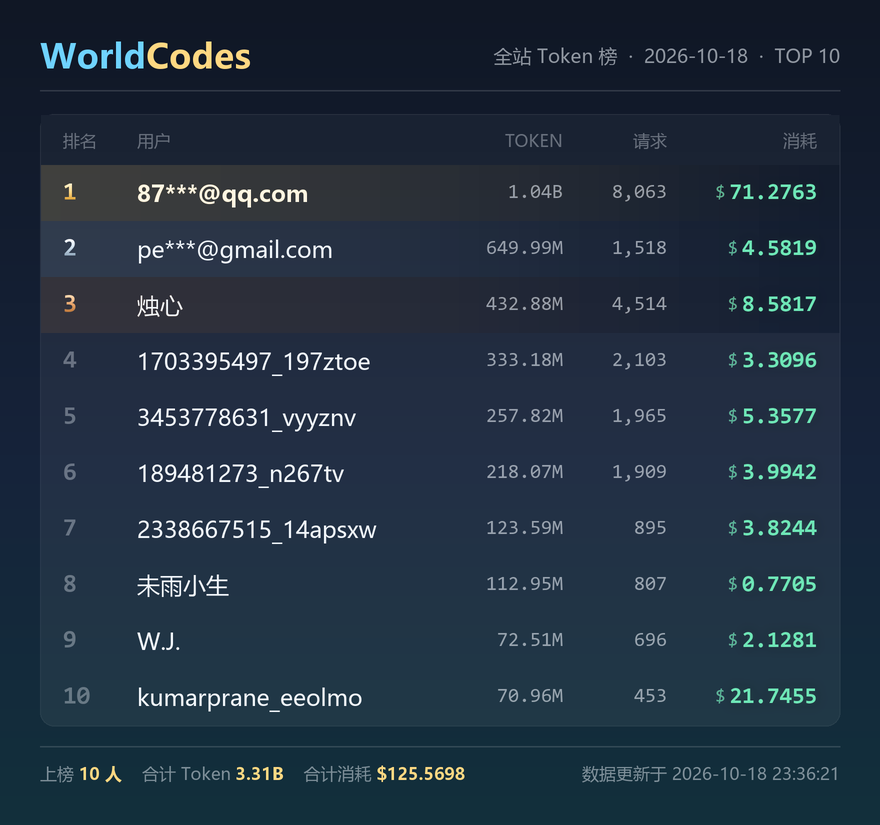

# astrbot_plugin_spending_rank · 全站每日双排行榜

API 中转站群的「全站每日排行榜」播报插件：群内一句 `/排行榜` 立刻出图，每晚到点自动把当日榜单推送进指定群。
接口同时给出 **Token 用量榜** 和 **消耗额度榜** 两套排名时，会画进同一张图左右并排；只有一套时自动退化为单榜。

它同时是一个 **LLM 工具**：群友随口说「看看榜」「今天谁用得最多」，模型会自己调用插件出图，不用记指令。

出图风格沿用钓鱼播报那套视觉语言（深蓝到青绿渐变底 + 金/青品牌字），**一行一个人**的紧凑榜单看板（非大卡片），宽度 880px、高度自适应。



---

## 一、文件结构

```
astrbot_plugin_spending_rank/
├── main.py             # 插件主逻辑：指令、定时任务、数据拉取与缓存、出图调度
├── local_render.py     # 本地渲染器：纯 Pillow 画榜单图，不联网、不装浏览器
├── template.html       # Jinja2 模板：远端渲染通道用的 HTML + CSS 排版
├── metadata.yaml       # 插件元数据（name/desc/version/author 为必填）
├── _conf_schema.json   # 插件配置表单（WebUI 读取，真正的默认值来源）
├── requirements.txt    # 运行依赖：httpx / jinja2 / pillow
├── preview.png         # 出图效果预览（真实接口数据渲染）
└── README.md
```

> 注：AstrBot 4.x 的插件配置由 `_conf_schema.json` 驱动（WebUI「插件配置」页渲染表单并写入 `data/config/<插件名>_config.json`）。
> `metadata.yaml` 里的 `config:` 段仅作可读性参考，框架不会读取它，改配置请改 `_conf_schema.json` 或在 WebUI 里改。

---

## 二、安装部署

### 1. 放入插件目录

把整个 `astrbot_plugin_spending_rank` 文件夹丢进 AstrBot 的插件目录：

```bash
# 源码部署（AstrBot 根目录）
cp -r astrbot_plugin_spending_rank /path/to/AstrBot/data/plugins/

# Docker 部署
docker cp astrbot_plugin_spending_rank <容器名>:/AstrBot/data/plugins/
```

放好后在 WebUI 的「插件管理」里点刷新/重载。

### 2. 安装 Python 依赖

**必须装到 AstrBot 运行所在的那个 Python 环境**（不是系统 Python）：

```bash
# 源码 / 虚拟环境部署
cd /path/to/AstrBot
source venv/bin/activate          # Windows: venv\Scripts\activate
pip install -r data/plugins/astrbot_plugin_spending_rank/requirements.txt

# Docker 部署
docker exec -it <容器名> pip install -r /AstrBot/data/plugins/astrbot_plugin_spending_rank/requirements.txt
```

只有两个依赖：`httpx`（请求接口）和 `jinja2`（模板注入）。

### 3. 出图环境：默认什么都不用装 ✅

出图默认走插件自带的**本地渲染器**（`local_render.py`，用 Pillow 直接画），所以：

- 不需要 `pip install playwright`，更不需要 `playwright install chromium`；
- 不需要访问任何远端渲染服务，**断网也能出图**；
- Docker 镜像不用加任何层，容器重建也不会丢东西。

唯一要求：**系统里有中文字体**。绝大多数镜像都有（Debian / Ubuntu 装过 `fonts-noto-cjk` 即可），容器里跑 `fc-list :lang=zh` 能列出来就行。

只有把 `render_mode` 设成 `remote`（或者用 `auto` 但本地渲染不可用）时，才会去调远端 t2i 渲染服务，那时才需要 AstrBot 所在机器能访问 `t2i_endpoint`。

---

## 三、配置说明

WebUI →「插件管理」→ 找到本插件 →「配置」。所有项都有默认值，**最少只需要填 `api_token` 和 `target_group`**。

| 配置项 | 类型 | 默认值 | 说明 |
| --- | --- | --- | --- |
| `api_url` | string | https://worldcodes.online/api/v1/leaderboard/daily | 排行榜接口地址 |
| `api_token` | string | 空 | 鉴权 Token，请求头带 Authorization: Bearer <Token> |
| `cache_ttl` | int | 300 | 数据缓存秒数，5 分钟内复用同一份数据；填 0 则每次实时拉取 |
| `request_timeout` | int | 10 | 接口请求超时（秒） |
| `top_n` | int | 10 | 榜单展示人数（**每个榜各取前 N 名**） |
| `panels` | string | dual | 展示哪几个榜：`dual` 双榜并排 / `tokens` 只出 Token 榜 / `cost` 只出消耗榜 |
| `cron_enabled` | bool | true | 是否开启每日定时播报 |
| `cron_time` | string | 23:00 | 每晚播报时间（24 小时制 HH:MM） |
| `target_group` | string | 空 | 定时播报目标群号；留空则跳过定时推送 |
| `platform_id` | string | aiocqhttp | 平台适配器 ID，用于拼会话串 |
| `show_cost` | bool | true | 是否展示消耗金额列（排名口径不受影响） |
| `brand` | string | WorldCodes | 左上角品牌字，前 5 个字符青色、其余金色 |
| `image_width` | int | 880 | 出图宽度（像素），高度自适应 |
| `image_format` | string | png | 出图格式：`png` 或 `jpeg` |
| `image_quality` | int | 92 | JPEG 画质（仅 `image_format = jpeg` 时生效） |
| `render_mode` | string | auto | 出图通道：`auto` 本地优先、本地挂了再走远端；`local` 只用本地；`remote` 只用远端；`text` 纯文本模式，永不出图 |
| `plain_fallback` | bool | true | 出图失败时自动把同一份数据排版成纯文字发出去，而不是只回一条报错 |
| `t2i_endpoint` | string | https://t2i.soulter.top/text2img | 远端渲染服务地址（仅远端通道使用），自建时改成自己的 |
| `render_timeout` | int | 60 | 单次出图超时（秒） |
| `llm_tool_enabled` | bool | true | 是否把「看榜」注册成 LLM 工具，让模型在群友说「看看榜」时自动调用并出图 |
| `llm_tool_send_image` | bool | true | LLM 调用看榜时是否直接把榜单图发到群里 |

### target_group 的两种写法

- 只填群号：`123456789` → 插件自动拼成 `aiocqhttp:GroupMessage:123456789`
- 填完整会话串：`aiocqhttp:GroupMessage:123456789`（跨平台/多适配器时更稳妥）

会话串格式来自 AstrBot 的 `unified_msg_origin`：`{platform_id}:{消息类型}:{会话ID}`，群聊消息类型固定是 `GroupMessage`。

---

## 四、使用方式

### LLM 自动看榜（推荐）

插件注册了一个函数调用工具 `get_daily_leaderboard`，**不用打指令**，群友随口说一句就会自动出图：

- 「看看榜」
- 「今天谁用得最多 / 谁花的钱最多」
- 「现在第一名是谁」
- 「排行怎么样」

模型会自己决定要不要调用、看哪个榜、列前几名。工具签名：

| 参数 | 类型 | 默认 | 说明 |
| --- | --- | --- | --- |
| `panel` | string | `all` | `all` 两个榜都看 / `token` 只看 Token 用量榜 / `cost` 只看消耗额度榜 |
| `top` | number | 5 | 文字摘要里每个榜列前几名，取 1–10 |
| `with_image` | boolean | true | 是否把榜单图直接发到当前会话 |

工作方式：工具先按 `top_n` 渲染完整榜单图**直接发到群**，再把「前 `top` 名 + 全站合计」的文字摘要回给模型，
让模型用一两句话点评。图归图、话归话，不会把整张榜在聊天里复述一遍。

两个前提：

1. 所用模型支持 **function calling / tools**（AstrBot →「服务提供商」里能看到该模型是否支持）；
2. `llm_tool_enabled` 保持开启。关掉后插件会主动把工具从全局工具表移除，模型不会再看到它，
   `/排行榜` 指令照常可用。

不想让模型每次调用都刷图，把 `llm_tool_send_image` 关掉即可 —— 此时工具只返回文字数据。

> 模型不支持函数调用时，用下面的指令方式，效果完全一样。

### 手动触发（被动）

群内发送以下任意一条，机器人立刻拉取当天数据并出图：

- `/排行榜`
- `/消费榜` / `/消费排行榜` / `/消费排行`（别名）
- `/看榜` / `/看看榜`（别名，和上面等价）

### 纯文本榜单

不想看图、或者当前环境根本渲染不出图时，有三种拿纯文字的方式：

| 方式 | 写法 | 作用范围 |
| --- | --- | --- |
| 临时指令 | `/排行榜 文字`、`/看榜 纯文本`、`/排行榜 txt` | 这一次只要文字，其余不变 |
| 全局配置 | `render_mode: text` | 从此不再出图，指令和定时播报都只发文字 |
| 自动兜底 | `plain_fallback: true`（默认开） | 出图失败时自动改发文字，群里不会只看到报错 |

文字版长这样（双榜就上下两段，名字按中英混排宽度对齐）：

```text
🏆 WorldCodes 今日榜单  2026-10-20

【消耗额度榜】
 1. zjh19          231.4521 tokens ·  352 次 · $231.4521
 2. 小明            88.1200 tokens ·  120 次 · $88.1200
【Token 用量榜】
 1. zjh19            1.23B tokens ·  352 次 · $231.4521

共 17 人上榜 · 合计 3.00B tokens · 合计 $465.6687
更新于 2026-10-20 15:20:11
```

> 文字和图片走的是同一份缓存数据，口径完全一致（每榜 `top_n` 名、页脚按人去重统计）。
> 出图成功后若图片发送环节被平台拒收，目前不会自动再补一条文字 —— 需要的话把 `render_mode` 直接设成 `text`。

### 自动触发（主动定时）

每晚 `cron_time` 到点，插件自动拉取当天数据（**强制绕过缓存，保证是当下最新数据**）并推送图片到 `target_group`。

定时任务实现要点：

- 用 `asyncio.create_task` 起一个后台协程，`asyncio.wait_for(self._stop_event.wait(), timeout=秒数)` 睡到下一个整点；
- 不轮询、不空转，时间到才唤醒执行推送；
- 推送后按 `cron_time` 重新计算下一次触发时间，天然跨天、跨重启；
- 插件 `terminate()`（停用 / 重载 / 卸载时触发）里会 set `stop_event` → cancel 任务 → 等待任务退出，
  **不会留下孤儿 Task**（出图走远端服务，本机没有常驻浏览器进程需要回收）。

修改 `cron_time` 后建议在 WebUI 里重载一次插件，让定时器立刻按新时间重排；`target_group` 每次推送前才读取，改完立即生效。

### 缓存行为

- `/排行榜`：命中缓存直接出图；未命中才打接口。
- 并发保护：`asyncio.Lock` + 双重检查，群里被 10 个人同时点也只会有 1 次真实请求。
- 定时播报：`force=True`，永远拉最新数据，不受缓存影响。

---

## 五、数据与容错

请求：`GET api_url`，超时 `request_timeout` 秒（默认 10 秒），自动跟随重定向。

已处理的异常，都会在群里给出**友好中文提示**而不是沉默或报错堆栈：

| 情况 | 提示 |
| --- | --- |
| 未配置 api_url | 插件未配置 api_url，请到 AstrBot 插件配置里填写接口地址 |
| 请求超时 | 请求排行榜接口超时（超过 10 秒），请稍后再试 |
| 网络错误 | 网络请求失败：<原始异常> |
| HTTP 401/403 | 接口返回 HTTP 403（api_token 可能无效或已过期） |
| HTTP 404 | 接口返回 HTTP 404（api_url 可能不正确） |
| 非 JSON 响应 | 接口返回内容不是合法 JSON…原始响应片段：<前 120 字> |
| 业务 code 异常 | 接口业务返回异常：code=… message=… |
| 今日无数据 | 📭 今日暂无 Token 消耗记录，榜单还是空的哦～ |
| 出图全线失败 | 不报错，自动降级成**纯文字榜单**发出去，数据照常可见（`plain_fallback: false` 时改为提示渲染失败） |

### 真实接口结构（重要）

线上接口返回的是**嵌套结构**，和常见文档示例（`data` 直接是数组）不一样，插件已完整适配：

```json
{
  "code": 0,
  "message": "success",
  "data": {
    "date": "2026-10-16",
    "timezone": "Asia/Shanghai",
    "currency": "USD",
    "generated_at": "2026-10-15T17:46:47Z",
    "ranking": [
      {
        "rank": 1,
        "user_id": 361,
        "display_name": "3453778631_vyyznv",
        "actual_cost": "1.449028376",
        "total_tokens": 129023480,
        "requests": 682
      }
    ]
  }
}
```

三个关键差异：列表在 `data.ranking` 里（不是 `data` 本身）、金额字段叫 `actual_cost` 且值是**字符串**、请求数字段叫 `requests`。

**两个榜怎么认**：`data.ranking` 是 Token 用量榜，`data.spending_ranking` 是消耗额度榜，两行结构完全一样。
两个字段都在 → 出双榜并排图；只有一个 → 出单榜；两个都没有 → 递归下钻找第一个列表当单榜。

> ⚠️ **关于接口自带的 `rank` 字段**：实测它与排序字段的顺序并不一致（当日 Token 最多的用户并不是 rank 1）。
> 本插件的口径是**按指标重新排名**：Token 榜按 `total_tokens` 降序，消耗榜按 `actual_cost` 降序，**忽略接口给的 `rank`**。
> 如果你确实想沿用接口原始顺序，把 `main.py` 里 `_rows_from_list()` 末尾那行 `rows.sort(...)` 注释掉即可（`rank` 会用列表原顺序重新编号）。

### 字段兼容兜底

多层兜底，接口改字段名也不会崩：

- 列表：`data` / `ranking` / `list` / `items` / `rows` / `result` / `records` / `leaderboard` / `entries`，并支持**递归下钻**（所以 `data.ranking` 这种嵌套也能挖出来）。
- 昵称：`display_name` / `displayName` / `nickname` / `username` / `name` / `email`，**全都取不到时回退为 `用户ID <user_id>`**。
- 金额：`cost` / `actual_cost` / `real_cost` / `total_cost` / `amount` / `spend` / `money` / `quota` …（字符串数值也能解析）
- Token：`total_tokens` / `tokens` / `token_count` …
- 请求数：`requests` / `request_count` / `count` / `calls` …
- 日期：`date` / `day` / `stat_date`，顶层取不到会自动去 `data` 里取；都缺失则用本机当天日期。
- 排序：Token 榜 **Token → 金额 → 请求数**，消耗榜 **金额 → Token → 请求数**，稳定排序（同分不打乱原有顺序）。

---

## 六、渲染细节

### 三条通道

出图由 `render_mode` 决定走哪条，默认 `auto`：

| 通道 | 实现 | 依赖 | 耗时 |
| --- | --- | --- | --- |
| 本地（`local_render.py`） | 纯 Pillow 逐像素绘制 | 只需中文字体 | ~1.4 秒 |
| 远端 html_render | `self.html_render(tmpl, data, return_url=True, options=…)` | 能访问 AstrBot 配置的渲染服务 | 视服务排队 |
| 远端直连 | `POST {t2i_endpoint}/generate`，请求头 `User-Agent: AstrBot/t2i` | 能访问 `t2i_endpoint` | 视服务排队 |

`auto` 的顺序是 **本地 → html_render → 直连**，任一通道成功就返回；三条全挂才降级成纯文字榜单。

### 为什么默认走本地

远端 t2i 是公共服务，限流就是 `HTTP 429`、没有可用节点就是 `HTTP 503`，插件当场发不出图——
这正是旧版本「榜单图片渲染失败」的直接原因。本地渲染器不碰网络，所以这两类错误从根上消失。
同时它也**不需要装 Chromium**：AstrBot 容器里 `playwright install` 要补一整套系统库，
而 Pillow 是 AstrBot 本来就有的依赖。

### 本地渲染器做了什么

1. 只取每个榜前 `top_n`（默认 10）名，每行带 `rank`、前三名额外高亮。
2. 2 倍超采样绘制（`SCALE=2`）再 LANCZOS 缩回，圆角和文字都没有锯齿。
3. 版式按 `template.html` 复刻：同样的深蓝→青绿渐变底、同样的金/青品牌字、同样的前三名金属渐变名次。
4. **双榜并排**：左栏消耗额度榜、右栏 Token 用量榜，各占一半宽度，每栏标题左侧有一条 3px 竖条（消耗榜绿色 / Token 榜青色）。
   栏内排「排名 / 用户 / 参照指标 / 请求数 / 本榜指标」五列——**本榜排名的那个指标永远放在最右侧**并用发光字强调，
   另一个指标压成灰字当参照，所以一眼就能看出这栏按什么排；请求数夹在中间作为活跃度参考。
   单榜时列序完全一致（排名 / 用户 / 参照指标 / 请求数 / 本榜指标），只是每列更宽。
5. **列宽自适应**：金额位数会变（`$6.5327` 和 `$820.2722` 差好几个字符），所以数字列宽不是写死的，
   每榜会按实际最长的一行重新量宽，避免长金额把 `$` 挤进左边一列。
6. 字体自动查找：优先 `NotoSansCJK-{Regular,Bold}.ttc`（`.ttc` 里先试 index=2 的简体字面），
   找不到再退到微软雅黑 / PingFang，数字用 DejaVuSansMono。全都没有时退回 Pillow 内置字体，不会崩。
7. 长昵称单行省略（按实际像素宽度二分截断），空榜显示「今天还没有人上榜」。
8. 出图在线程池里跑（`asyncio.to_thread`），不阻塞 AstrBot 的事件循环。
9. **页脚统计按人去重**：同一人可能同时进两个榜，所以「上榜 N 人」和合计 Token / 合计消耗都只累加一次，
   双榜各 10 名而实际只有 13 人时，页脚写的就是 13 人；`top_n` 小于接口返回条数时按真正画出来的行重算，不会出现图上 10 行、页脚 40 人的错位。

### 远端通道细节

- Jinja2 把数据注入 `template.html`（`autoescape` 开启，昵称里的尖括号不会破坏版面）。
  模板载入时会先用占位数据试渲染一次，模板写坏了会在日志里立刻看到。
- 渲染选项为 `{"full_page": true, "type": "png"}`（或 `jpeg` + `quality`）——服务端整页截图，上下都不留白。
- 拿到图片地址后下载字节流，转 Base64，通过 `event.chain_result([Image.fromBase64(b64)])` 发送
  （失败时自动回退 `event.image_result("base64://…")`）。
- 远端通道加 `asyncio.Lock` 串行化，避免定时任务与手动指令同时打渲染服务。

> 模板里 `<head>` 会被 AstrBot 注入一段 Shiki 代码高亮脚本（约 1.2MB），这是框架行为，不影响本模板样式。

---

## 七、常见问题排查

**Q：以前出图老是失败，报 429 / 503**
A：那是旧版本只会调远端 t2i 服务造成的。现在默认走本地渲染器，**不联网也能出图**，这两类错误不会再出现。
如果仍然出不了图，插件会自动降级成纯文字榜单，数据照样能看到；日志里搜 `[SpendingRank]` 能看到是哪条通道挂了。

**Q：本地渲染器为什么没生效 / 想调试它**
A：日志里正常会有一行 `[SpendingRank] 本地渲染器已就绪（纯 Pillow，不依赖网络）`。
看不到这行、或者出现 `本地渲染器加载失败`，通常是 Pillow 没装或 `local_render.py` 被漏传了：
`pip install pillow`，并确认插件目录里 6 个文件都在（`main.py`、`local_render.py`、`template.html`、`metadata.yaml`、`_conf_schema.json`、`requirements.txt`）。
想单独验证，可以在插件目录里跑：

```bash
python -c "import local_render; print(len(local_render.render_leaderboard([], {'date':'x','updated_at':'x'})))"
```

**Q：图片里的中文变成方块 / 豆腐块**
A：容器里没有中文字体。`apt install -y fonts-noto-cjk` 后重载插件即可（Debian/Ubuntu 系通用）。

**Q：渲染服务返回 403**
A：渲染接口校验 `User-Agent`，必须是 `AstrBot/t2i`。插件已固定带上，若你改过 `T2I_USER_AGENT` 记得改回来。

**Q：图片出得很慢（每次 4~6 秒）**
A：那是走远端通道的耗时（模板里用 CDN 引入了 MiSans 字体，服务端每次出图都要拉一遍）。
改成 `render_mode: local` 就走本地渲染，**约 1.4 秒**出图；也可以用 `image_format: jpeg` 减小图片体积。

**Q：出图里「用户」列被挤成只剩一两个字，右侧还多出一截空白**
A：这是配置里的 `image_width` 还是旧值（1.0 版默认 600）造成的——AstrBot 载入配置时只补缺失项，**不会覆盖你已保存的值**，所以升级插件后旧宽度会留在 `data/config/astrbot_plugin_spending_rank_config.json` 里。去 WebUI 插件配置把「出图宽度」改成 880（或直接删掉该配置文件让默认值生效）即可。
模板本身也做了兜底：用户列下限 220px、整页 `min-width: min-content`，宽度配小时只会把图撑宽（600 会出成 814px 宽），不会再出现姓名变残字、右侧留空白。

**Q：定时到点了但没发出去（日志提示找不到平台适配器）**
A：`platform_id` 与 `target_group` 没对上。建议直接填完整会话串 `aiocqhttp:GroupMessage:<群号>`；
或先拉一次该群的日志，看 AstrBot 打印的 `unified_msg_origin` 长什么样，照着填。

**Q：启动日志报 "Task was destroyed but it is pending"**
A：本插件不会出现——`terminate()` 里已 cancel 并 await 掉定时任务。若仍有，检查是否有其他插件泄漏 Task。

**Q：日志出现「读取系统代理设置失败（Invalid port: ':1]'），已忽略代理环境变量改为直连」**
A：这是 httpx 的环境兼容问题：系统 `NO_PROXY` 里写了**带方括号的 IPv6**（如 `[::1]`），httpx 解析代理列表时会直接抛 `Invalid port`，
导致连 `AsyncClient` 都构造不出来、请求根本发不出去。插件已自动降级为忽略代理直连，只打一条 warning，**不影响使用**。
若服务器确实需要走代理，请把 `NO_PROXY` 里的 `[::1]` 改成不带方括号的 `::1`。

**Q：用 WebUI「上传安装」时报 `FileNotFoundError: … /plugin/astrbot_plugin_spending_rank`**
A：这是 **zip 打包方式**的问题，不是插件本身的问题。AstrBot 多在 Linux/Docker 上跑，解压用的是 Python 的 `zipfile`，而 `zipfile` **只认 `/` 作路径分隔符**。
Windows 自带的「压缩为 zip」和 PowerShell 5.1 的 `Compress-Archive` 会把条目名写成**反斜杠**（`插件名\main.py`），这违反 ZIP 规范：
Linux 解压出来只是一个名字里带反斜杠的**单文件**，目录压根不存在，于是 `os.listdir` 抛 FileNotFoundError。
请使用本仓库自带的 zip（用 Python `zipfile` 打过，条目全为正斜杠），或改用会写 `/` 的工具重新打包：7-Zip、`tar -a -c -f astrbot_plugin_spending_rank.zip astrbot_plugin_spending_rank`、Python `zipfile`。
实在不行可以直接**绕开 zip**，把文件夹整个拷进插件目录：

```bash
# 源码部署
cp -r astrbot_plugin_spending_rank /path/to/AstrBot/data/plugins/
# Docker 部署（容器内路径一般是 /AstrBot/data/plugins/）
docker cp astrbot_plugin_spending_rank <容器名>:/AstrBot/data/plugins/
```

**Q：接口返回 401/403**
A：`api_token` 填错或过期；注意不要自己加 `Bearer ` 前缀，插件会自动拼。

**Q：想改配色 / 排版 / 品牌字**
A：品牌字改配置项 `brand` 即可（前 5 个字符青色、其余金色）。

- 默认的本地渲染：改 `local_render.py` 顶部的调色板常量（`GOLD` / `CYAN` / `MINT` / `BG_STOPS`）和版式常量（`PAD_X`、`COL_RANK`、`COL_TOKENS` 等列宽、`NAME_SIZE` 等字号）。
- 走远端通道时：改 `template.html`，配色都在文件顶部 `:root` 的 CSS 变量里（`--cyan` / `--gold` / `--mint` / `--cols` 列宽等）。

两边改完都重载插件生效。

**Q：想单独同步数据但不想出图**
A：日志里每次刷新都会打印「榜单数据已更新：<日期> 共 N 人，本次展示前 M 名」，可据此确认取数正常。

---

## 八、日志

统一使用 AstrBot 日志器（符合插件规范，不使用 `import logging`）：

```python
from astrbot.api import logger
logger.info("[SpendingRank] …")
```

启动时会打印定时计划（每天几点、推送到哪个会话），每次刷新数据会打印上榜人数，异常会带堆栈便于定位。
